

# Manual Oficial de Usuario · Shalev

**Sistema de Punto de Venta e Inventario para Pequeños Negocios**

**Versión 1.0** · Aplicación nativa para Android (Android 8.0 o superior) · **100 % sin conexión**

---

## Índice de contenidos

1. [¿Qué es Shalev y qué necesitas para empezar?](#1-qué-es-shalev-y-qué-necesitas-para-empezar)
2. [Primeros pasos y configuración inicial](#2-primeros-pasos-y-configuración-inicial)
3. [Conoce la pantalla, la barra inferior y los botones](#3-conoce-la-pantalla-la-barra-inferior-y-los-botones)
4. [Pantalla de Inicio: el centro de control de tu negocio](#4-pantalla-de-inicio-el-centro-de-control-de-tu-negocio)
5. [El turno de trabajo y el arqueo de caja](#5-el-turno-de-trabajo-y-el-arqueo-de-caja)
6. [Inventario: productos, insumos y elaborados con receta](#6-inventario-productos-insumos-y-elaborados-con-receta)
7. [Catálogo de Servicios](#7-catálogo-de-servicios)
8. [Vender y cobrar en Efectivo o por Transfermóvil](#8-vender-y-cobrar-en-efectivo-o-por-transfermóvil)
9. [Pago electrónico y ajustes automáticos de Precios](#9-pago-electrónico-y-ajustes-automáticos-de-precios)
10. [Registros, clientes fijos y correcciones en turno abierto](#10-registros-clientes-fijos-y-correcciones-en-turno-abierto)
11. [Exportar informes, listas de precios y tarjetas promocionales](#11-exportar-informes-listas-de-precios-y-tarjetas-promocionales)
12. [Apps vinculadas: trabajar con tus empleados en red local](#12-apps-vinculadas-trabajar-con-tus-empleados-en-red-local)
13. [Respaldo (.shalev), restauración y cambio de teléfono](#13-respaldo-shalev-restauración-y-cambio-de-teléfono)
14. [Tu licencia, precios, renovación y actualizaciones](#14-tu-licencia-precios-renovación-y-actualizaciones)
15. [Seguridad, preguntas frecuentes y soporte técnico](#15-seguridad-preguntas-frecuentes-y-soporte-técnico)

---

## 1. ¿Qué es Shalev y qué necesitas para empezar?

**Shalev** es una aplicación Android creada especialmente para pequeños negocios en Cuba —cafeterías, mercados, mipymes, puntos de venta, barberías, salones de belleza, talleres, lavanderías y servicios a domicilio— que necesitan llevar sus ventas, su caja y su inventario al día sin depender de internet.

### Principales ventajas para tu negocio

| Característica | Qué significa en el trabajo diario |
|---|---|
| **Funciona 100 % sin internet** | Vendes, cobras con código QR, consultas ganancias y exportas informes aunque no tengas datos móviles ni conexión exterior. |
| **Tus datos quedan protegidos en tu teléfono** | No existen cuentas en la nube, servidores externos, anuncios ni rastreo. Toda la información del negocio se guarda protegida dentro de tu propio equipo. |
| **Cobro en efectivo y por Transfermóvil** | Genera al instante el código QR oficial para tu tarjeta o cuenta bancaria y permite verificar y registrar el número de transacción del SMS de confirmación. |
| **Recetas, insumos y servicios** | Descuenta automáticamente harina, queso, café o materiales al vender un producto elaborado o prestar un servicio, y te dice para cuántas unidades te alcanza lo que tienes. |
| **Trabajo en equipo sin gastar saldo** | Vincula hasta **10 teléfonos de empleados** con tu teléfono principal usando solo la Wi-Fi del local o la Zona Wi-Fi de tu propio móvil. |
| **7 días de prueba gratuita** | Al instalar Shalev dispones de 7 días completos con todas las funciones y hasta 5 apps secundarias de empleados antes de adquirir una licencia. |

### Requisitos mínimos del equipo

- **Sistema operativo:** teléfono o tableta con **Android 8.0** o superior.
- **Cámara (opcional):** solo se utiliza si deseas tomar fotos para tu catálogo o escanear el código QR para vincular el teléfono de un empleado.
- **Bloqueo de pantalla (opcional):** si configuras huella, rostro, patrón o PIN en tu teléfono, podrás activar además el **Acceso con clave** de Shalev.

---

## 2. Primeros pasos y configuración inicial

La primera vez que abres Shalev aparecen dos ayudas muy breves para dejar la aplicación lista en menos de dos minutos: la lista de permisos iniciales y el recorrido de bienvenida.

### 2.1 Permisos de la primera apertura

Al arrancar por primera vez, Shalev explica en lenguaje claro para qué sirve cada permiso antes de pedírtelo:

1. **Cámara:** para fotografiar productos o servicios y escanear el código QR al vincular empleados.
2. **Notificación de turno:** para mostrarte en la barra superior del teléfono cuándo dejaste un turno abierto o el avance de una sincronización.
3. **Fotos:** se pide una sola vez para conservar la fecha de tu periodo de prueba en caso de reinstalación.

Puedes pulsar **Continuar** para concederlos o **Ahora no** si prefieres seguir adelante; si niegas alguno, Shalev solo volverá a pedirlo cuando uses la función que lo necesita.

### 2.2 El recorrido inicial paso a paso

Tras la pantalla de bienvenida, el asistente te guía por preguntas sencillas. Puedes saltar las opcionales y completarlas más tarde desde **Ajustes → Completar configuración**:

1. **Tipo de app (*Principal* o *Secundaria*):**
   - **Principal (dueño):** es el teléfono central del negocio. Guarda toda la base de datos, el catálogo, los precios, los respaldos y la licencia. Solo hay **un teléfono principal** por negocio.
   - **Secundaria (empleado):** es el teléfono de un trabajador que se conecta al teléfono del dueño mediante un código QR.
2. **Acceso con clave (opcional):** activa la protección con tu huella, tu rostro o el PIN del teléfono al abrir Shalev.
3. **Tu negocio:** marca qué módulos vas a usar (**Ventas**, **Inventario** y/o **Servicios**). Lo que no uses no ocupará espacio en pantalla; si marcas *Ventas*, se activa también *Inventario* porque lo necesita.
4. **Empleados:** indica cuántos empleados usarán su propia app secundaria (puedes cambiarlo después al pedir tu licencia).
5. **Tus datos:** escribe tu nombre, apellidos, carné de identidad y teléfono. Se emplean en el cobro por transferencia y al solicitar tu licencia.
6. **Avisos de inventario:** elige a partir de qué cantidad quieres que Shalev te avise de **Stock bajo** (por defecto `5`) y **Stock crítico** (por defecto `1`), tanto para productos en unidades enteras como para insumos en su medida (`kg`, `L`, `g`, etc.).
7. **Periodo de prueba:** confirma el inicio de tus 7 días gratuitos y pulsa **Empezar a usar Shalev**.

> **Atención — La elección entre Principal y Secundaria es definitiva:** una vez que configuras tu teléfono como **App Principal**, nunca puede convertirse en secundaria desde los ajustes para evitar pérdidas accidentales de la base de datos del negocio. Si alguna vez necesitaras cambiar el rol del teléfono, primero exporta un respaldo y borra los datos de la aplicación en los ajustes de Android.

| 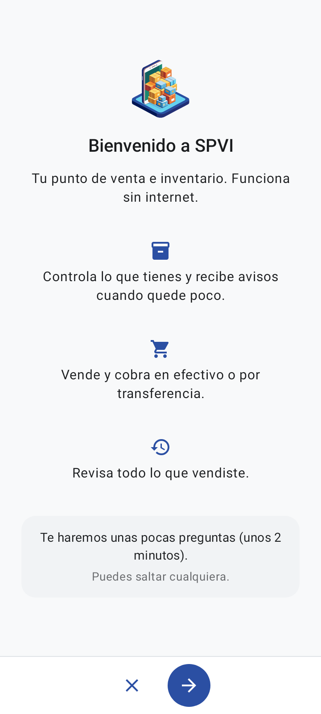 | 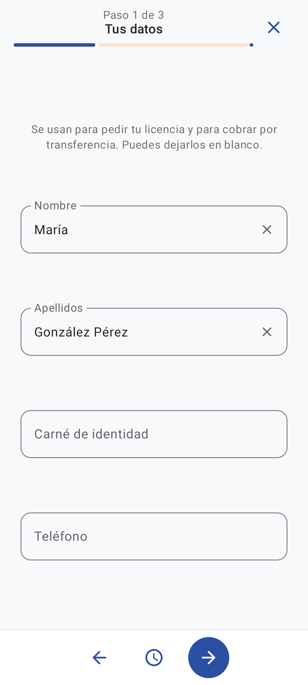 | 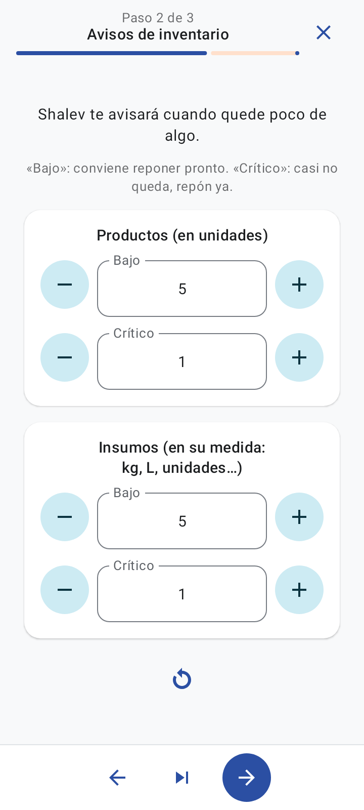 |
|:---:|:---:|:---:|
| *Figura 2.1 — Bienvenida a Shalev* | *Figura 2.2 — Datos del titular* | *Figura 2.3 — Umbrales de stock bajo y crítico* |

---

## 3. Conoce la pantalla, la barra inferior y los botones

Shalev está pensada para manejarse con una sola mano de forma ágil detrás del mostrador. Todas las pantallas principales se organizan alrededor de **5 secciones** situadas en la barra inferior.

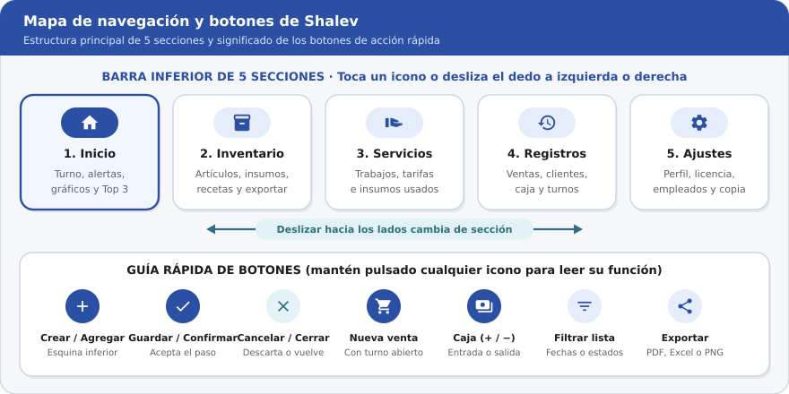

### 3.1 Cómo moverte entre secciones

- **Tocar un icono de la barra inferior:** el icono activo se destaca con fondo relleno para que sepas siempre dónde estás (**Inicio**, **Inventario**, **Servicios**, **Registros** o **Ajustes**).
- **Deslizar el dedo hacia la izquierda o la derecha:** en cualquiera de las 5 pantallas principales puedes deslizar horizontalmente para pasar a la sección vecina. Para evitar errores mientras trabajas, el gesto de deslizar se desactiva automáticamente cuando estás escribiendo, filtrando, seleccionando filas o dentro de una ventana emergente.

### 3.2 Botones limpios de solo icono

Para que la pantalla se mantenga despejada incluso en teléfonos compactos o con letra grande, los botones de acción de Shalev muestran **únicamente su icono**. Si tienes duda sobre qué hace un botón, **mantenlo pulsado un instante** y aparecerá un cartelito con su nombre exacto.

| Icono / ubicación | Qué hace | Dónde lo encontrarás |
|---|---|---|
| **+** *(abajo a la derecha)* | Crear o agregar un elemento nuevo | Inventario, Servicios, Pago electrónico, Precios y Apps vinculadas |
| **✓** *(botón relleno principal)* | Guardar formulario o confirmar operación | Alta de productos/servicios, comprobante de venta, diálogos y filtros |
| **✕** *(botón secundario)* | Cancelar, descartar o cerrar sin guardar | Formularios, carrito de venta y ventanas de confirmación |
| **→** *(flecha siguiente)* | Avanzar al siguiente paso de un asistente | Recorrido inicial, carrito de venta, Respaldo y Licencia |
| **Carrito** *(flotante inferior izquierdo)* | Iniciar una **Nueva venta** | Pantalla de Inicio (solo visible con el turno abierto) |
| **Billetes** *(flotante inferior derecho)* | Registrar **Entrada / salida de efectivo** | Pantalla de Inicio (solo visible con el turno abierto) |
| **Embudo** *(arriba a la derecha)* | Abrir la ventana **Filtrar** | Inventario, Servicios y Registros |
| **Compartir** *(arriba a la derecha)* | **Exportar** a PDF, Excel, Imagen o Tarjetas | Inventario, Servicios, Registros y detalle de Turno |

### 3.3 Tema claro, tema oscuro y letra grande

Shalev sigue automáticamente el **modo claro** o **modo oscuro** configurado en tu teléfono Android, garantizando siempre alto contraste para leer sin esfuerzo tanto a plena luz del sol como de noche. Además, respeta el **tamaño de fuente del sistema** (hasta el 200 % de ampliación) pasando los textos e importes a varias líneas sin recortar cifras.

| 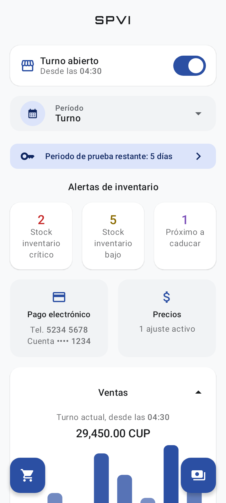 | 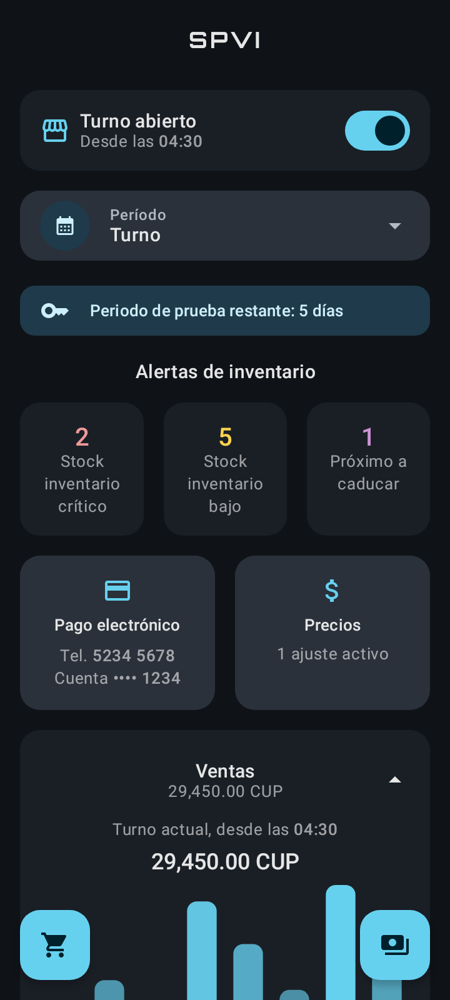 |
|:---:|:---:|
| *Figura 3.1 — Interfaz en modo claro* | *Figura 3.2 — Interfaz en modo oscuro* |

---

## 4. Pantalla de Inicio: el centro de control de tu negocio

Al abrir Shalev entras siempre por la parte superior de **Inicio**. La pantalla está dividida en una cabecera fija arriba y un área desplazable debajo con las alertas y estadísticas de tu negocio.

### 4.1 El bloque fijo superior

Mientras bajas para revisar tus números, tres elementos permanecen **siempre fijos a la vista** en la parte alta:

1. **Tarjeta del Turno con interruptor:** muestra si tienes el **Turno cerrado** (*«Ábrelo para vender»*) o el **Turno abierto** con la hora desde la que comenzó. Tocar el interruptor abre o inicia el cierre del turno.
2. **Selector de Período:** permite elegir qué etapa deseas analizar en los gráficos (**Turno** actual, **Hoy**, **7 días**, **Este mes**, **Este año**, etc.).
3. **Aviso de licencia o avisos importantes:** te informa cuántos días restan de tu prueba o de tu licencia cuando se acerca el vencimiento, si llevas más de 30 días sin hacer copia de seguridad o si hay una actualización disponible.

### 4.2 Alertas, accesos rápidos, gráficos y medallas Top 3

Al deslizar hacia abajo en la app principal verás:

- **Alertas de inventario:** recuadros con contadores de colores para **Sin existencia**, **Stock crítico**, **Stock bajo**, **Insumo crítico**, **Insumo bajo**, **Próximo a caducar** (productos que vencen en los próximos 7 días) y avisos de nombres repetidos sin descripción. Tocar una alerta te lleva directamente a esos artículos.
- **Tarjetas de acceso rápido:**
  - **Pago electrónico:** muestra en seminegrita el teléfono y la tarjeta o cuenta que tienes activos hoy para cobrar por transferencia.
  - **Precios:** indica cuántos ajustes automáticos de precio están encendidos.
- **Gráficos y rankings plegables (acordeones):** empiezan cerrados para mantener el orden visual; toca cualquiera para desplegarlo:
  - **Ventas:** evolución de tus ingresos en CUP durante el período elegido.
  - **Ganancia Neta:** comparativa visual entre **Venta**, **Costo** y porcentaje de margen.
  - **Inventario:** gráfico circular de distribución de tus existencias por categoría.
  - **Métodos de pago:** proporción cobrada en efectivo frente a transferencia.
  - **Rankings Top 3 con medallas de oro, plata y bronce:** productos más vendidos, artículos de lento movimiento, mayor rentabilidad y —en los últimos 30 días— los **3 mejores vendedores (empleados)** y los **3 mejores clientes por transferencia**.

| 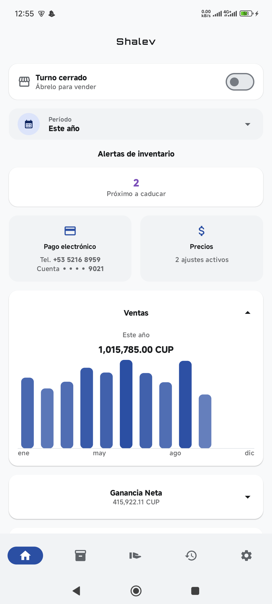 | 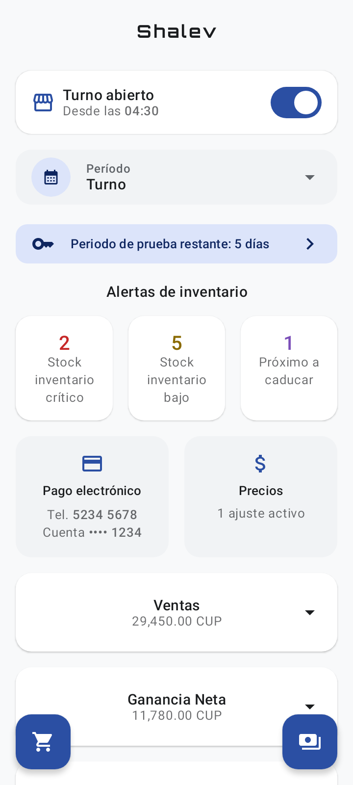 |
|:---:|:---:|
| *Figura 4.1 — Inicio con turno cerrado y gráfico desplegado* | *Figura 4.2 — Turno abierto, alertas y botones de venta y caja* |

---

## 5. El turno de trabajo y el arqueo de caja

En Shalev rige una regla sencilla que mantiene tus cuentas claras todos los días: **no se puede vender sin tener un turno abierto**. El turno representa una jornada de trabajo completa, desde que recibes el efectivo inicial de la gaveta hasta que cuadras el dinero y las existencias al terminar.

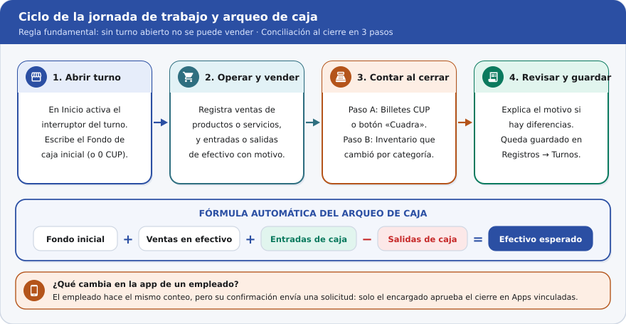

### 5.1 Abrir el turno y fondo de caja

1. En **Inicio**, activa el interruptor de la tarjeta **Turno cerrado**.
2. Se abrirá el cuadro **Abrir turno** pidiendo el **Fondo de caja (CUP)**.
   - Shalev te propone automáticamente el efectivo que contaste al cerrar el turno anterior, pero puedes escribir cualquier importe (incluso `0` si empiezas sin cambio).
   - En las apps de empleados también escribe el fondo quien abre el turno (al abrirlo, su teléfono se sincroniza automáticamente con la principal para trabajar con el catálogo al día).
3. Pulsa **Confirmar (✓)**. En **Inicio** aparecerán los dos botones azules flotantes abajo: **Nueva venta** (izquierda) y **Movimiento de caja** (derecha).

> **Consejo:** mientras tu turno esté abierto, verás una notificación discreta de Shalev en la barra superior de Android con el tiempo transcurrido. No muestra importes ni nombres de clientes para proteger tu privacidad, y tocarla te devuelve enseguida a la app.

### 5.2 Registrar entradas y salidas de efectivo durante el turno

Si sacas dinero de la caja para pagar a un proveedor, comprar hielo o bolsas, o si metes cambio adicional durante el día, regístralo para que la caja no descuadre al final:

1. Con el turno abierto, toca el botón flotante de **billetes** (abajo a la derecha en **Inicio**).
2. En la ventana **Entrada / salida de efectivo**, elige la pestaña **Entrada** o **Salida**.
3. Escribe el **Importe (CUP)** y un **Motivo** claro (de 3 a 60 caracteres, por ejemplo: *«Compra de cambio menudo»* o *«Pago de mensajería»*).
4. Confirma con **✓**. Por seguridad contable, los movimientos de caja no se borran: si te equivocaste en uno, anota el movimiento contrario explicando la corrección.

### 5.3 Cerrar el turno en 3 pasos (efectivo + inventario + revisión)

Al finalizar la jornada, desactiva el interruptor de **Turno abierto** en **Inicio**:

1. **Paso 1 — Conteo de efectivo por billetes:**
   - Shalev muestra el **Efectivo esperado** calculado automáticamente (`Fondo + Ventas en efectivo + Entradas − Salidas`).
   - Escribe cuántos billetes tienes de cada denominación (**1, 3, 5, 10, 20, 50, 100, 200, 500, 1000, 5000 y 20000 CUP**) y añade aparte las **Monedas / otro efectivo**. Los campos vacíos valen cero.
   - ¿Prefieres no contar billete por billete? Pulsa el icono de **Omitir el conteo de billetes** (esquina inferior derecha del cuadro) para escribir directamente el total en efectivo o pulsar el botón rápido **Cuadra** cuando el efectivo contado coincide exactamente con el esperado.
2. **Paso 2 — Conteo parcial de inventario por categorías:**
   - Para ahorrarte tiempo, Shalev **solo te pide contar los productos e insumos que se movieron durante ese turno**, organizados en pestañas por categoría (*Bebidas*, *Alimentos*, *Insumos*…). Lo que no se tocó se da por bueno.
   - Los artículos usan números enteros y los insumos admiten hasta **3 decimales** (con punto o coma, p. ej. `1.250`). Escribe `0` si se agotó alguno. Los productos *Elaborados* no aparecen aquí porque se controlan contando sus insumos reales.
   - Si no deseas hacer conteo físico en ese momento, toca **Omitir el conteo de inventario** (esquina inferior derecha): el turno se cerrará sin modificar tus existencias y quedará anotado *«Conteo de inventario omitido»*.
3. **Paso 3 — Revisión y confirmación:**
   - Revisa en pantalla el efectivo contado y cualquier diferencia de inventario. Si hay faltantes o sobrantes de stock, escribe el **Motivo del ajuste** (de 3 a 160 caracteres) y pulsa **Confirmar (✓)**.
   - En la **App Principal**, los ajustes de existencias y el cierre del turno se guardan juntos en ese instante. En una **App Secundaria de empleado**, confirmar envía la declaración al encargado para que la revise y apruebe en **Apps vinculadas**.

| 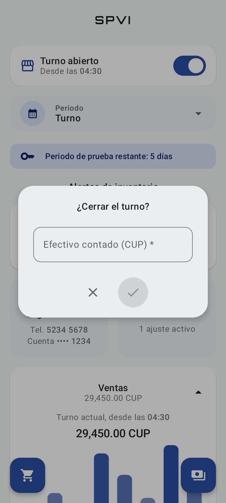 | 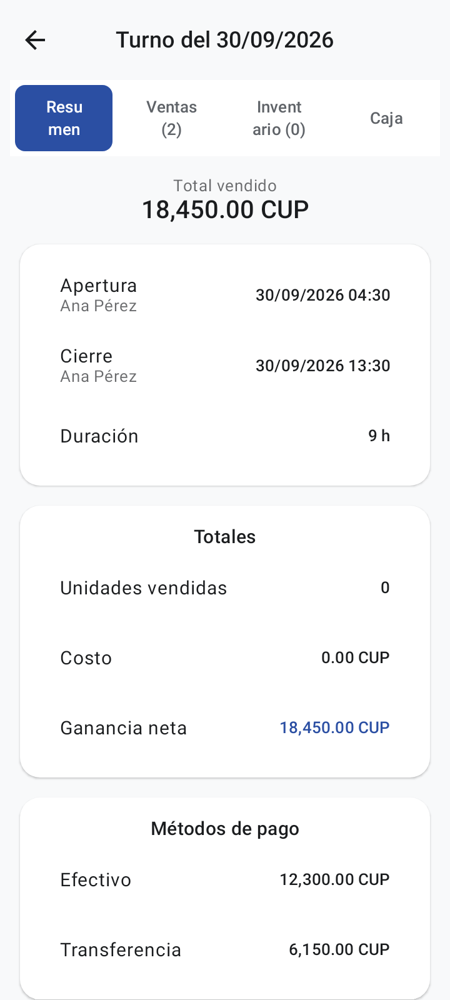 |
|:---:|:---:|
| *Figura 5.1 — Conteo de billetes por denominación CUP* | *Figura 5.2 — Informe guardado en Registros → Turnos* |

---

## 6. Inventario: productos, insumos y elaborados con receta

La sección **Inventario** reúne todo lo físico que compras, transformas o vendes en tu negocio.

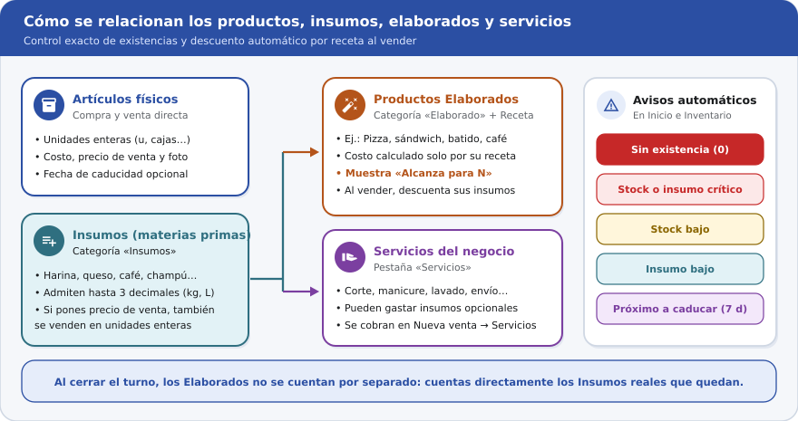

### 6.1 Cómo leer la lista de Inventario

Cada fila te da de un vistazo toda la información clave sin tener que abrirla:

- **Barra lateral izquierda de color:** azul cuando todo está en orden, amarilla/petróleo en nivel bajo y roja en nivel crítico o sin existencia.
- **Casilla de selección y miniatura de foto:** permite marcar uno o varios artículos para exportarlos o borrarlos.
- **Centro:** nombre (y descripción si la tiene), debajo la cantidad disponible con su unidad (`20 u`, `4.5 kg`, o *«Alcanza para 62»* si es un elaborado) y debajo la categoría.
- **Derecha:** arriba en seminegrita el **precio de venta** y debajo, en tono secundario, el **precio de costo** para no confundirlos nunca (los insumos sin precio de venta solo muestran su costo).

### 6.2 Agregar un artículo físico paso a paso

1. Entra en **Inventario** y pulsa el botón **+** de la esquina inferior derecha.
2. **Foto opcional (arriba del todo):** toca el icono de **Cámara** para tomar una foto al instante o **Galería** para elegir una imagen que ya tengas en el teléfono.
3. **Categoría \*:** elige una existente o escribe una nueva (por ejemplo: *Bebidas*, *Aseo personal*, *Bodega*, *Confituras*).
4. **Nombre \* y Descripción:** escribe el nombre comercial. Si tienes dos artículos con el mismo nombre (por ejemplo, dos formatos de *Refresco*), usa **Descripción** para distinguirlos (*«Lata 355 ml»*, *«Pomo 1.5 L»*).
5. **Fecha de caducidad (opcional):** si el producto vence, márcala para que Shalev te avise en Inicio **7 días antes**.
6. **Precio de costo \* y Precio de venta \*:** escribe ambos en CUP (admite punto o coma decimal). Por seguridad contra pérdidas, el precio de venta debe ser mayor que el de costo.
7. **Cantidad inicial \*:** cuántas unidades tienes ahora mismo.
8. Pulsa **Guardar (✓)** en la barra inferior.

### 6.3 Insumos y Productos Elaborados (recetas)

Si tienes una cafetería, pizzería, dulcería o taller de producción, Shalev calcula por ti cuánto cuesta preparar cada producto y cuántas raciones puedes vender:

1. **Primero crea tus materias primas (Insumos):**
   - Ve a **Inventario → +** y en **Categoría** elige **Insumos** (si ya tenías puesto el filtro *Insumos*, el formulario se abre directamente en ese modo).
   - Escribe el nombre (*Harina de trigo*, *Queso gouda*, *Azúcar*, *Café molido*), elige su unidad (`kg`, `g`, `L`, `ml`, `u`), su costo por unidad y la existencia actual (admite hasta **3 decimales**, como `2.500 kg`).
   - *Opcional:* si además vendes ese insumo suelto al público, escríbele un **Precio de venta** (se venderá por unidades enteras). Si solo lo usas para cocinar o producir, deja el precio de venta vacío.
2. **Después crea el Producto Elaborado con su receta:**
   - Ve a **Inventario → +** y en **Categoría** elige **Elaborado** (en singular).
   - Escribe el nombre (p. ej. *Pizza napolitana* o *Sándwich de jamón*).
   - En el bloque **Receta \*** (*Insumos de UNA unidad*), agrega cada ingrediente e indica cuánto gasta **una sola unidad** (por ejemplo: `0.25 kg` de harina, `0.10 kg` de puré de tomate y `0.08 kg` de queso).
   - Verás que Shalev calcula sola el **Precio de costo** sumando los ingredientes de la receta. Tú solo eliges el **Precio de venta** y guardas con **✓**.

> **¿Qué ocurre al vender un Elaborado?** En la lista de Inventario y en el carrito verás siempre **«Alcanza para N»** calculado según el ingrediente más escaso. Cada vez que vendas uno, Shalev descontará automáticamente las porciones exactas de cada insumo. Cuando algún ingrediente no alcance, Shalev impedirá venderlo para que el inventario nunca quede en negativo.

### 6.4 Buscar, filtrar y seleccionar varios elementos

- **Buscador:** escribe cualquier parte del nombre, descripción o categoría para localizar al instante un producto.
- **Filtrar (icono de embudo arriba a la derecha):** combina tres selectores muy cómodos:
  1. **Estado:** *Todos*, *Stock bajo*, *Stock crítico*, *Próximos a caducar* o *Sin existencia*.
  2. **Tipo:** *Todos*, *Artículos*, *Elaborados* o *Insumos*.
  3. **Categoría:** cualquiera de las categorías de tu negocio.
- **Selección múltiple:** marca las casillas cuadradas a la izquierda de los productos para ver la barra superior con el conteo de elegidos, el botón de **Seleccionar todo** y las acciones sobre el lote seleccionado (como exportar únicamente esos productos).

| 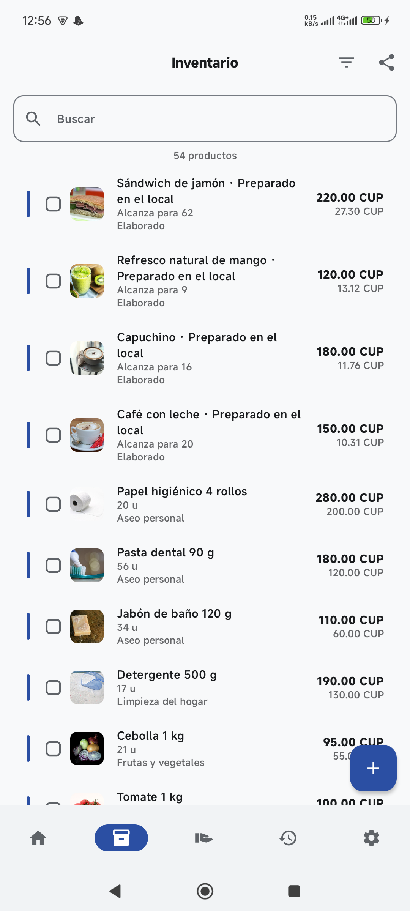 | 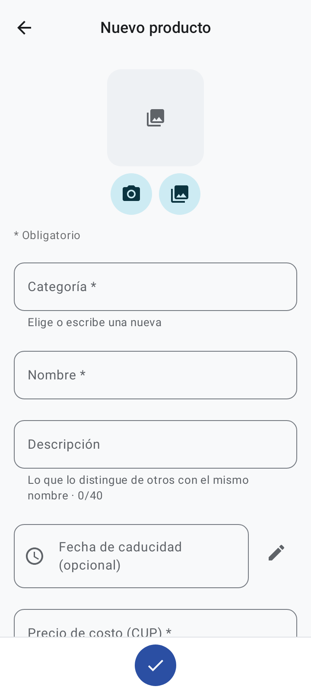 | 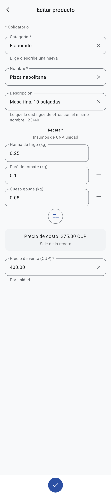 |
|:---:|:---:|:---:|
| *Figura 6.1 — Lista de Inventario con fotos y alcance* | *Figura 6.2 — Alta de producto con cámara o galería* | *Figura 6.3 — Receta y costo automático de un Elaborado* |

---

## 7. Catálogo de Servicios

La tercera pestaña de la barra inferior, **Servicios**, está dedicada a todo lo que cobras por tu trabajo y que no es un artículo almacenado en estantería: cortes de cabello, manicure, tinte, lavado o planchado de ropa, reparaciones técnicas, instalación de aplicaciones, fotocopias o entregas a domicilio.

### Cómo crear y usar tus servicios

1. Entra en **Servicios** y toca el botón **+** (abajo a la derecha).
2. Añade una **foto** opcional con Cámara o Galería.
3. Escribe el **Nombre \*** (p. ej. *Corte de cabello* o *Lavado y peinado*), el **Tipo \*** (*Barbería*, *Belleza*, *Lavandería*, *Telefonía*, *Domicilio*…) y el **Importe (CUP) \*** que cobras cada vez.
4. Si tienes servicios parecidos, añade una **Descripción** breve (hasta 40 caracteres).
5. **Insumos que gasta (opcional):** si cada vez que realizas ese servicio consumes algún material de tu inventario (por ejemplo, champú, tinte, detergente o bolsas de regalo), agrégalo con su cantidad. Al cobrar el servicio, Shalev descontará esos insumos automáticamente y calculará tu ganancia real descontando su costo.
6. Guarda con **✓**.

| 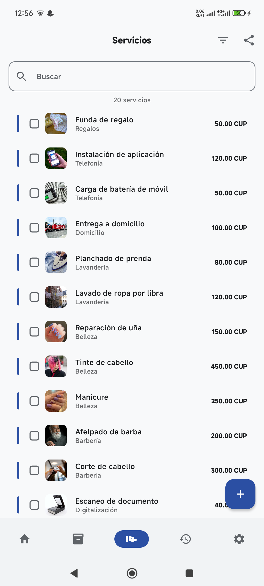 | 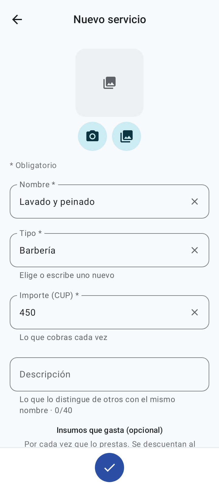 |
|:---:|:---:|
| *Figura 7.1 — Catálogo de Servicios por especialidad* | *Figura 7.2 — Formulario de Nuevo servicio con insumos opcionales* |

---

## 8. Vender y cobrar en Efectivo o por Transfermóvil

Con tu **turno abierto**, vender lleva solo unos segundos y evita errores de suma o de vuelto.

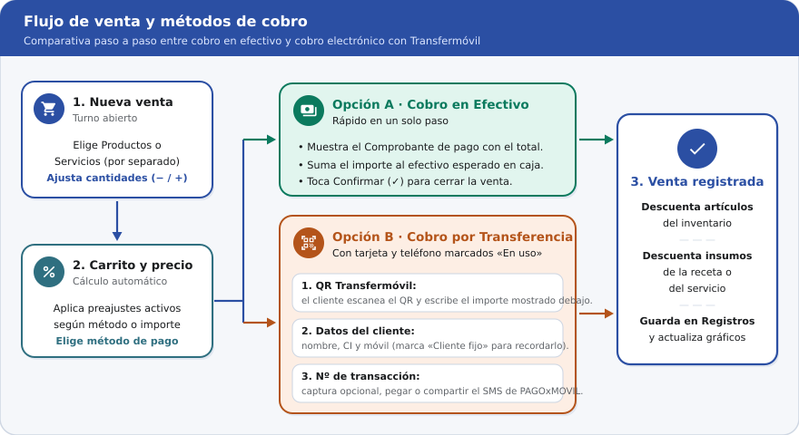

### 8.1 Armar el carrito de la venta

1. En **Inicio**, toca el botón flotante del **Carrito (Nueva venta)** abajo a la izquierda.
2. Si tu negocio vende tanto artículos como servicios, elige si deseas registrar una venta de **Productos** o de **Servicios** (se cobran por separado para mantener tus estadísticas ordenadas).
3. Toca los artículos o servicios que pide el cliente para añadirlos y revisa el carrito:
   - Ajusta las unidades con los botones **−** y **+** o escribiendo el número en el recuadro **Cantidad**.
   - Si quieres añadir algo más sin perder lo que ya marcaste, pulsa el botón redondo de **agregar al carrito** debajo de la lista.
   - Arriba verás siempre el **Total estimado** actualizado al instante.
4. En **Método de pago**, elige **Efectivo** o **Transferencia** y pulsa **Siguiente (→)**.

### 8.2 Cobrar en Efectivo

Si elegiste **Efectivo**, Shalev muestra directamente el **Comprobante de pago** con el desglose de artículos, cualquier preajuste aplicado y el **Total** arriba en grande. Cobra al cliente y pulsa **Confirmar (✓)**: el dinero se suma al efectivo esperado de la caja y las existencias se descuentan en el acto.

### 8.3 Cobrar por Transferencia (Transfermóvil)

Antes de tu primer cobro electrónico, asegúrate de haber marcado una tarjeta y un teléfono **«En uso»** en *Pago electrónico* (ver Capítulo 9). Al elegir **Transferencia** en la venta:

1. **Pantalla del Código QR:**
   - Muéstrale al cliente el código QR en pantalla para que lo escanee desde **Transfermóvil**.
   - **Detalle muy importante:** el formato oficial del QR de Transfermóvil transporta tu tarjeta y tu móvil de confirmación, pero **no incluye el importe**. Por eso Shalev muestra el **Importe a transferir** bien grande justo debajo del QR para que el cliente lo escriba sin equivocarse.
2. **Datos del cliente y Clientes fijos:**
   - Avanza al formulario **Datos de la transferencia** y completa el **Nombre y apellidos**, el **Carné de identidad** y el **Teléfono** del cliente.
   - **Clientes fijos:** si es un comprador habitual, marca la casilla **Cliente fijo**. La próxima vez que empieces a escribir su nombre, Shalev te sugerirá hasta 3 clientes guardados y con un toque rellenará su carné y su teléfono automáticamente.
3. **Registrar el Nº de transacción (3 vías cómodas):**
   Cuando el cliente envía el pago, recibes el SMS bancario de **PAGOxMOVIL**. Puedes incorporar el número de operación de cualquiera de estas tres maneras (o escribirlo a mano):
   - **Captura automática opcional:** si activas el *Acceso a notificaciones* cuando te lo ofrece la tarjeta informativa de la pantalla del QR, Shalev detectará el número y comprobará el importe automáticamente mientras esta venta espera el pago (sin permiso para leer tu buzón de SMS antiguos ni guardar el mensaje completo).
   - **Botón Pegar:** copia el SMS recibido y toca el botón redondo del **portapapeles** en la pantalla de datos; Shalev extrae el código de transacción y te avisa si el importe del SMS no coincide con el total de la venta.
   - **Compartir SMS con Shalev:** desde la app de Mensajes del teléfono, comparte el texto del SMS hacia Shalev.
4. Pulsa **Confirmar (✓)** para dejar registrada la venta y su transferencia asociada.

| 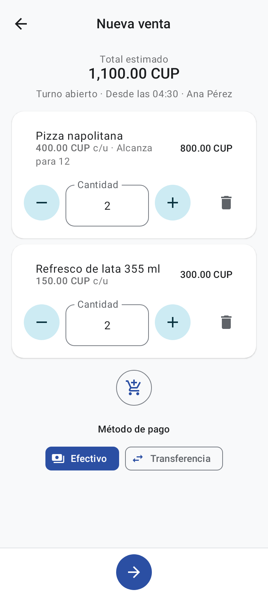 | 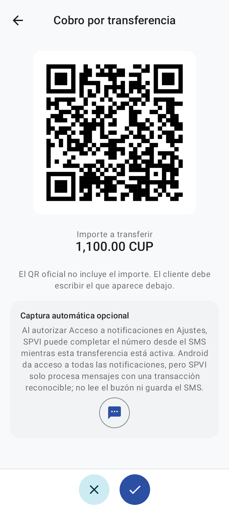 | 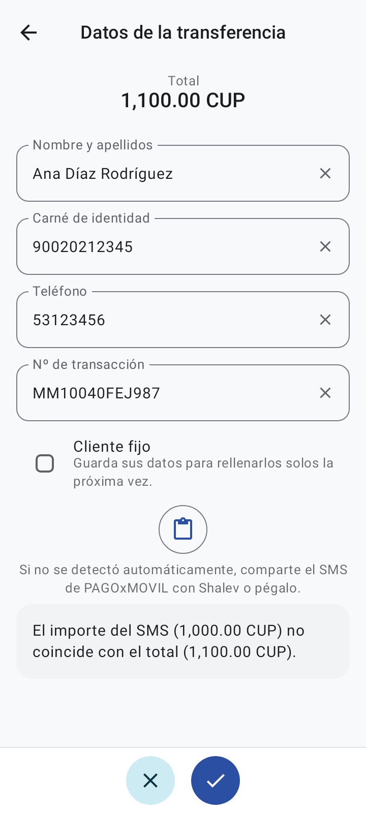 |
|:---:|:---:|:---:|
| *Figura 8.1 — Carrito con cantidades y método de pago* | *Figura 8.2 — QR de Transfermóvil e importe debajo* | *Figura 8.3 — Cliente fijo y verificación del SMS* |

---

## 9. Pago electrónico y ajustes automáticos de Precios

Puedes entrar a ambas opciones tanto desde las tarjetas de acceso rápido de **Inicio** como desde el menú **Ajustes**.

### 9.1 Configurar Pago electrónico

En **Pago electrónico** administras la lista de teléfonos y tarjetas o cuentas bancarias de tu negocio:

1. Toca el botón **+** (abajo a la derecha) para desplegar las dos opciones: **Otro teléfono** o **Otra tarjeta o cuenta** (admite entre 12 y 20 dígitos, con un alias opcional para reconocerla rápido).
2. Marca con su casilla **un teléfono** (el que recibirá el SMS de confirmación) y **una tarjeta o cuenta** (la que recibirá el dinero).
   - Solo puede haber uno de cada tipo marcado a la vez: marcar otro sustituye automáticamente al anterior, y tocar el que ya está marcado lo desmarca.
   - En las listas, los números de tarjeta aparecen siempre protegidos (`•••• 6454`). Shalev muestra de forma orientativa las siglas o el logo del banco (**BPA**, **BANDEC** o **BANMET**) según los primeros 4 dígitos conocidos, aunque recuerda verificar siempre tus dígitos al guardarla.

### 9.2 Ajustes automáticos de Precios (descuentos y recargos)

¿Haces un descuento en ventas grandes al por mayor o aplicas un ajuste según el método de pago? En **Precios** puedes crear reglas automáticas sin tener que cambiar uno por uno los precios guardados en tu inventario:

1. Entra en **Precios** y pulsa **+** (abajo a la derecha).
2. Elige si la regla **Sube** (hasta un `+100 %`) o **Baja** (hasta un `-90 %`) el precio y escribe el porcentaje (por ejemplo, `5` o `10`).
3. Elige cuándo se aplica:
   - **Método de pago:** *Cualquiera*, *Solo Efectivo* o *Solo Transferencia*.
   - **Importe mínimo (opcional):** por ejemplo, solo en compras a partir de `5000 CUP`.
4. Marca a qué productos se aplica y guarda con **✓** (Shalev te muestra una vista previa del cambio antes de guardar, pero nunca rebaja un artículo por debajo de su precio de costo).
5. En la lista de **Precios**, usa el interruptor de la derecha para encender o apagar cada regla cuando quieras.

| 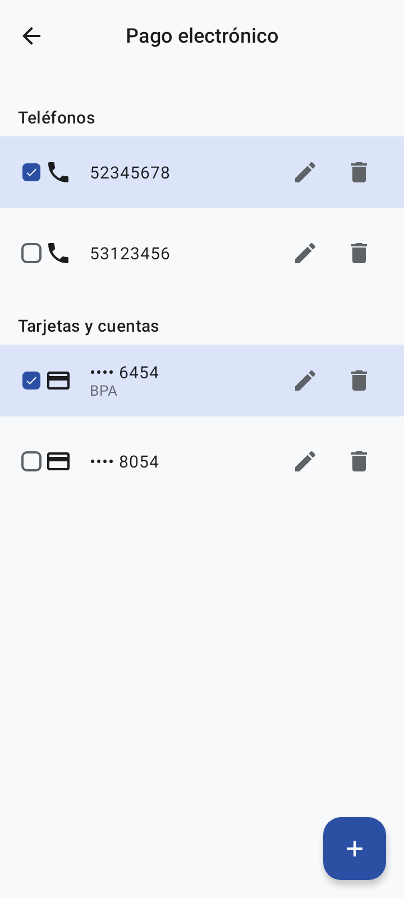 | 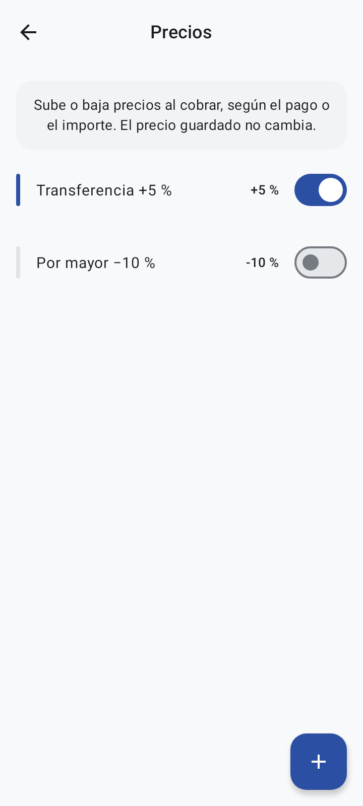 |
|:---:|:---:|
| *Figura 9.1 — Teléfono y tarjeta seleccionados para cobrar* | *Figura 9.2 — Reglas de subida o rebaja con interruptor* |

---

## 10. Registros, clientes fijos y correcciones en turno abierto

La sección **Registros** guarda todo el historial ordenado por fecha para que puedas auditar cualquier operación en segundos.

### 10.1 Las 6 pestañas de Registros

En la fila superior desplazable tienes seis vistas especializadas:

1. **Ventas:** todas las ventas de productos con su fecha, vendedor, importe total y estado (*Válida*, *Anulada* o *Corrige #N*).
2. **Servicios:** historial independiente de los servicios cobrados.
3. **Transferencias:** registro bancario con fecha, nº de transacción, cliente, carné, teléfono, vendedor e importe.
4. **Movimientos:** cada entrada, salida, venta o ajuste de existencias de tus productos e insumos, indicando el cambio y la existencia resultante.
5. **Clientes:** directorio de tus **Clientes fijos** guardados al cobrar por transferencia. Al tocar un cliente ves el historial completo de sus compras; en el pie centrado de su ficha tienes los botones **Editar** (para corregir nombre, carné o teléfono actualizando también sus compras anteriores, siempre que el carné no pertenezca ya a otro cliente) y **Quitar de clientes fijos**.
6. **Turnos:** lista de todos los turnos abiertos y cerrados. Al tocar uno accedes a sus cuatro pestañas internas: **Resumen**, **Ventas**, **Inventario** (conciliación y diferencias) y **Caja** (desglose del arqueo, billetes contados, entradas y salidas).

### 10.2 Filtrar registros

Pulsa el icono de **embudo (Filtrar)** arriba a la derecha:
- En **Ventas**, **Servicios** y **Transferencias** puedes filtrar por **período de fechas**, por **importe mínimo y máximo**, y por **vendedor**.
- En **Movimientos** la ventana pide únicamente el **período**, ya que un movimiento de existencias mide cantidades y no dinero.

### 10.3 Corregir o anular operaciones (con el turno abierto)

¿Se cobró por error en efectivo cuando era transferencia, se anotó una unidad de más o hubo un desliz en un ajuste manual? Mientras el **turno siga abierto** y estés usando la **App Principal** (los turnos ya cerrados quedan congelados para proteger tu contabilidad):

- **En una Venta o un Servicio (o desde la ficha de su Transferencia):** abre la ficha tocando la fila y elige:
  - **Modificar:** abre una pantalla completa donde puedes cambiar cantidades, quitar o añadir artículos, cambiar el método de pago y corregir el nº de transacción, escribiendo un breve motivo (3 a 60 caracteres). La operación original queda trazada y enlazada con la venta corregida (*«Corrige #N»*).
  - **Anular:** pide el motivo, marca la venta como **ANULADA** (deja de sumar en totales y en la caja) y devuelve automáticamente las existencias al inventario. *(Nota: si el cliente ya había transferido dinero, recuerda hacerle la devolución desde Transfermóvil, pues Shalev no mueve fondos bancarios).*
- **En un Movimiento de tipo Ajuste:** abre su ficha en *Registros → Movimientos* y toca **Editar ajuste**. Escribe la nueva cantidad y el motivo: Shalev corrige tu stock actual y recalcula la *«existencia después»* de los movimientos posteriores de ese turno.

| 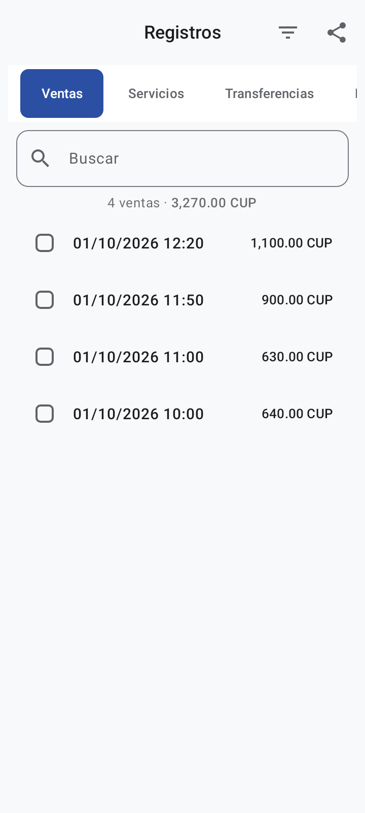 | 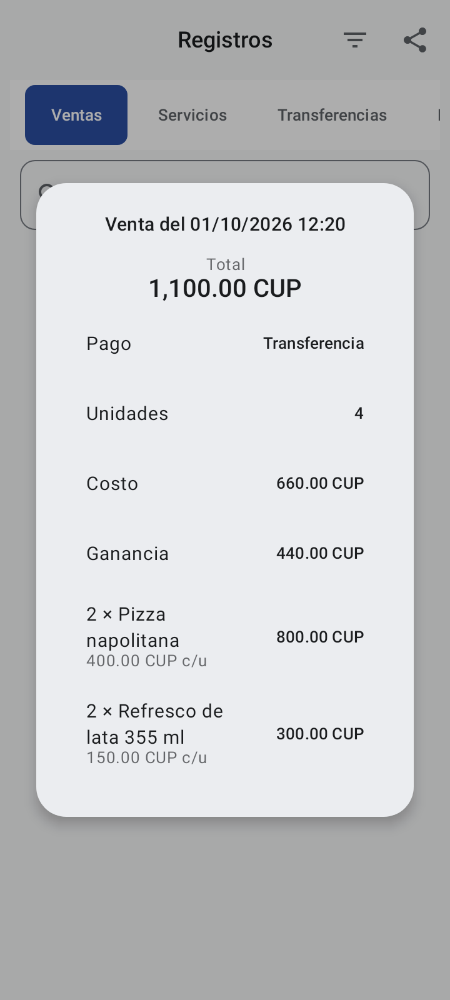 |
|:---:|:---:|
| *Figura 10.1 — Pestañas de Registros y selección múltiple* | *Figura 10.2 — Ficha de una venta con costo y ganancia* |

---

## 11. Exportar informes, listas de precios y tarjetas promocionales

Shalev distingue claramente entre los **documentos internos de administración** (que incluyen costos, ganancias o datos de clientes) y las **imágenes comerciales para publicar o enviar a tus clientes** (que jamás muestran costos ni existencias).

> **Consejo de selección:** en **Inventario**, **Servicios** y **Registros**, si marcas algunas filas con su casilla cuadrada, solo se exportarán los elementos marcados. Si no marcas ninguno, se exportará todo lo que esté visible según tu búsqueda o filtro actual.

### Qué puedes exportar desde cada lugar

| Desde dónde | Formato | Destinatario | Qué contiene y cómo sale |
|---|---|---|---|
| **Inventario** | **PDF / Excel (`.xlsx`)** | Uso interno *(incluye costos)* | Informe completo de artículos e insumos con existencias, costos, precios y caducidad. Se puede **Guardar** en el teléfono o **Enviar**. |
| **Inventario** | **Imagen (`.png`)** | Para clientes *(sin costos)* | Lista limpia de precios ordenada por categoría y producto (hasta 25 filas por imagen; excluye insumos sin venta). |
| **Inventario** | **Tarjetas promocionales (`.png`)** | Para clientes *(sin costos)* | Catálogo visual con foto, nombre, categoría y precio (hasta 6 tarjetas por imagen). Admite un **Encabezado de promoción opcional** de hasta 160 caracteres arriba de cada imagen (p. ej. *«¡Ofertas del fin de semana en Cafetería María!»*). |
| **Ficha de un producto** | **Imagen / Tarjeta (`.png`)** | Para clientes *(sin costos)* | Tarjeta grande individual del producto lista para publicar en estados de WhatsApp, Telegram o redes sociales. |
| **Servicios** | **PDF / Excel** e **Imagen / Tarjetas** | Interno o para clientes | Informe administrativo completo en PDF/Excel o catálogo promocional de servicios en PNG sin costos. |
| **Registros** *(Ventas, Servicios, Transferencias, Movimientos)* | **PDF / Excel (`.xlsx`)** | Uso interno | Tablas con totales calculados, importes en formato CUP listos para sumar en Excel y páginas A4 automáticas (en horizontal cuando superan 5 columnas). |
| **Detalle de un Turno** | **PDF / Excel (`.xlsx`)** | Uso interno | Informe integral del turno: resumen, arqueo de caja, billetes contados, conciliación de inventario, ventas y movimientos. |

> **Privacidad al compartir:** revisa siempre a quién envías un PDF o Excel de **Transferencias**, ya que como documento contable del negocio contiene el nombre, carné de identidad completo y teléfono de tus compradores.

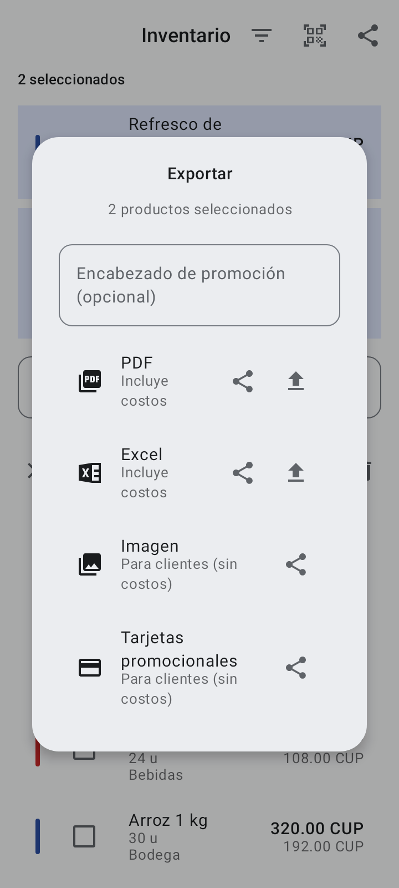

*Figura 11.1 — Opciones de exportación de Inventario diferenciando uso interno y material para clientes*

---

## 12. Apps vinculadas: trabajar con tus empleados en red local

Si trabajas con dependientes, cajeros o barberos, cada empleado puede instalar Shalev en su propio teléfono como **App Secundaria** y conectarse a tu **App Principal** sin gastar datos móviles ni necesitar internet.

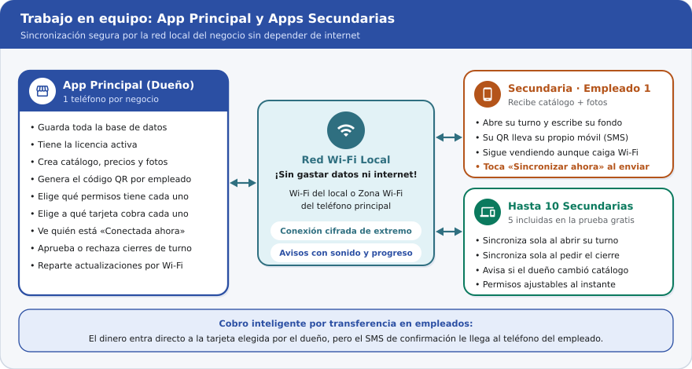

### 12.1 Qué necesitan ambos teléfonos para conectarse

Solo hace falta estar en la **misma red local**:
- Conectados ambos al **router Wi-Fi del local**, o bien
- Activando la **Zona Wi-Fi (punto de acceso portátil)** en el teléfono principal del dueño y conectando a ella los teléfonos de los empleados (no hace falta encender los datos móviles).

### 12.2 Cómo vincular el teléfono de un empleado por primera vez

1. **En el teléfono del dueño (Principal):**
   - Ve a **Ajustes → Apps vinculadas** y toca el botón **+** (abajo a la derecha).
   - Escribe el nombre del empleado (por ejemplo, *Ana* o *Luis*). Se generará un **código QR temporal** en pantalla.
2. **En el teléfono del empleado (Secundaria):**
   - En el recorrido inicial elige **Secundaria (empleado)** (o entra en **Ajustes → Apps vinculadas → Usar esta app como secundaria**).
   - Escribe el **número de teléfono móvil del empleado** (8 dígitos que empiecen por 5 o 6) y escanea con la cámara el código QR que muestra el teléfono del dueño.
   - Al vincularse, la app secundaria descarga automáticamente el catálogo, los precios, los permisos asignados y las **fotos de productos y servicios**.

### 12.3 Permisos, cobro por transferencia y sincronización

Al tocar el nombre de un empleado en **Ajustes → Apps vinculadas** de la principal, el dueño controla todo:

- **Permisos individuales:** por defecto un empleado nuevo puede **Vender productos**, **Vender servicios** y **Exportar y compartir**. El dueño decide si además le activa **Editar inventario y servicios** o **Cambiar precios**.
- **Tarjeta de cobro del empleado:** elige a cuál de tus tarjetas bancarias irán las transferencias que cobre ese trabajador. Su código QR combinará **tu tarjeta bancaria** con **el número móvil del propio empleado**, de modo que el dinero cae directo en tu cuenta pero el SMS de confirmación de PAGOxMOVIL le llega al teléfono del empleado para que pueda comprobar el pago al instante sin interrumpirte.
- **Conexión abierta y sincronización controlada:**
  - Mientras estén en la misma Wi-Fi, la app del empleado mantiene la conexión abierta y el dueño ve **«Conectada ahora»**.
  - **Sincronización manual:** para ahorrar batería y evitar interrupciones en medio de una cola, el empleado toca el botón central **Sincronizar ahora** en *Apps vinculadas* cuando desea enviar sus ventas pendientes (*«N pendientes de enviar»*) y recibir novedades. Si el dueño cambia precios o productos, la app del empleado le muestra el aviso *«El dueño cambió el catálogo. Sincroniza para recibirlo»*.
  - **Sincronizaciones automáticas esenciales:** ocurren solas al **abrir un turno** (para no vender nunca con precios viejos) y al **solicitar el cierre del turno**.
  - **Barra de avance y avisos sonoros:** mientras viajan los datos verás una barra de progreso en la notificación y en *Apps vinculadas*, acompañada de sonidos diferenciados cuando un empleado se conecta, se desconecta o termina de sincronizar (personalizables en los ajustes de notificaciones de Android).
  - **¿Y si se va la Wi-Fi o el dueño sale del local?** El empleado **sigue vendiendo con total normalidad** durante todo su turno abierto; solo necesitará volver a sincronizar para cerrar el turno o abrir uno nuevo.

### 12.4 Cómo se cierra el turno de un empleado

1. El empleado toca cerrar su turno, realiza su conteo de efectivo e inventario y confirma: su app envía una **solicitud de cierre** (o bien el dueño puede tocar **Pedir cierre del turno** desde su teléfono, lo cual esperará siempre a que el empleado termine cualquier venta en curso).
2. El encargado entra en **Apps vinculadas → empleado**, revisa el efectivo esperado frente al contado y las diferencias de stock, y pulsa **Aprobar cierre** (aplicando en ese momento los ajustes al inventario central) o **Rechazar cierre** para que el empleado vuelva a contar.

| 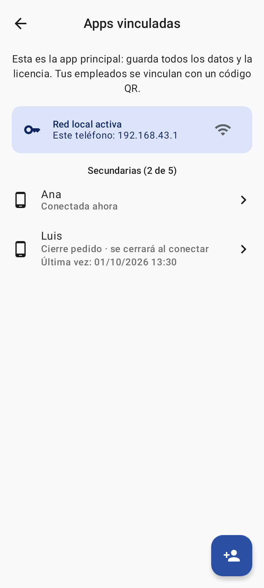 | 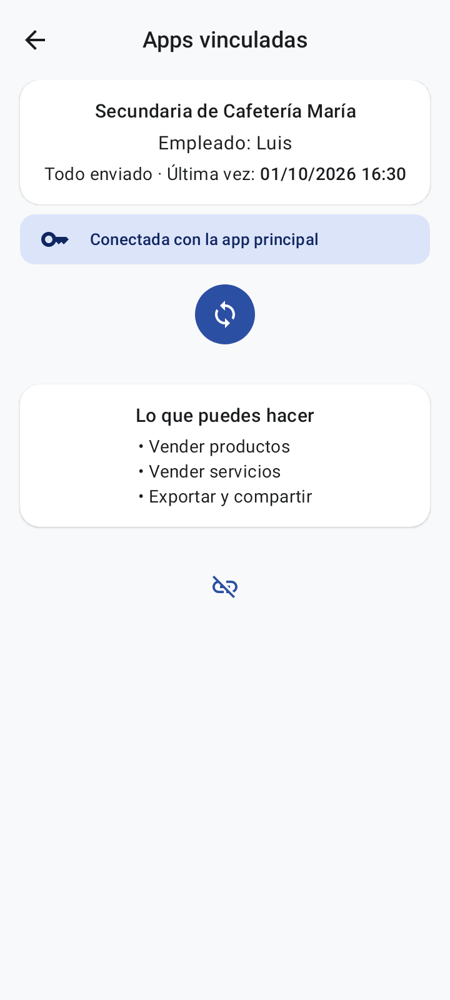 |
|:---:|:---:|
| *Figura 12.1 — Vista del dueño con estado de conexión y turnos* | *Figura 12.2 — Vista del empleado con permisos y botón Sincronizar* |

---

## 13. Respaldo (.shalev), restauración y cambio de teléfono

Como todos tus datos viven únicamente en tu teléfono y no en internet, hacer copias de seguridad periódicas es tu mejor seguro ante roturas, extravíos o cambios de equipo. Si pasan **30 días** sin exportar una copia, Shalev te mostrará un recordatorio amistoso en **Inicio**.

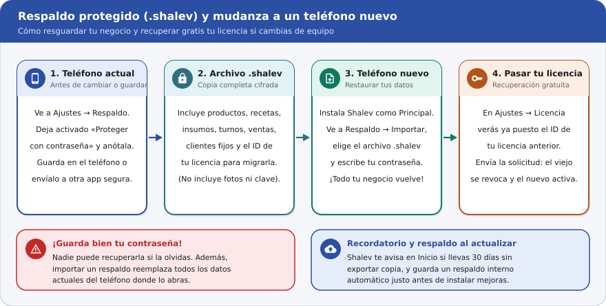

### 13.1 Cómo guardar una copia de seguridad (Exportar)

1. En la app principal, ve a **Ajustes → Respaldo**.
2. En la tarjeta **Exportar**, verás activada por defecto la opción **Proteger con contraseña**:
   - Escribe una contraseña de al menos 8 caracteres, repítela debajo y **anótala en un lugar seguro**.
   - *(Puedes apagar el interruptor si prefieres guardarla sin clave, pero recuerda que cualquier persona que consiga ese archivo podría abrirlo con Shalev y ver tus ventas y clientes).*
3. Toca **Siguiente (→)** y elige **Guardar en el teléfono** (en tu carpeta *Descargas*) o **Enviar** a otra aplicación segura (Google Drive, Telegram, correo o tarjeta SD). El archivo se llamará `Shalev_respaldo_AAAA-MM-DD.shalev`.

### 13.2 Qué incluye y qué NO incluye el archivo `.shalev`

| Sí va dentro del respaldo `.shalev` | No va dentro del respaldo (tómalo en cuenta) |
|---|---|
| Todos tus productos, recetas, insumos y servicios | **Las imágenes de las fotos** (en un teléfono nuevo los artículos conservan todos sus datos, pero aparecen sin foto) |
| Todos los turnos, arqueos de caja, ventas, transferencias y movimientos | **La licencia activa en sí** (está ligada al teléfono, aunque el respaldo **sí guarda el ID** para que la recuperes gratis en el nuevo) |
| Tu perfil, tarjetas, teléfonos, preajustes de precios y **clientes fijos** | **Los códigos QR activos de vinculación** (los nombres y permisos de los empleados se conservan, pero deberás generarles un QR nuevo) |

### 13.3 Cómo restaurar una copia (Importar) y mudarte de teléfono

> **Atención:** importar un archivo `.shalev` **reemplaza TODOS los datos actuales** del teléfono por los de la copia. Si algún archivo estuviera incompleto o dañado (por ejemplo, un envío por Bluetooth cortado a la mitad), Shalev lo detecta antes de empezar y deja tus datos intactos.

Si cambiaste de teléfono, sigue estos 4 pasos en orden:

1. En el teléfono viejo, exporta un respaldo `.shalev` recién hecho y pásalo al teléfono nuevo.
2. Instala Shalev en el teléfono nuevo y elige **Principal (dueño)** en el recorrido inicial.
3. Ve a **Ajustes → Respaldo → Importar**, pulsa el botón de **Elegir archivo**, selecciona tu `.shalev` y escribe tu contraseña.
4. Por último, entra en **Ajustes → Licencia**: verás ya relleno automáticamente el campo **ID de la licencia anterior**. Envía la solicitud de recuperación para recibir sin costo tu licencia en el teléfono nuevo con el mismo vencimiento y cantidad de secundarias.

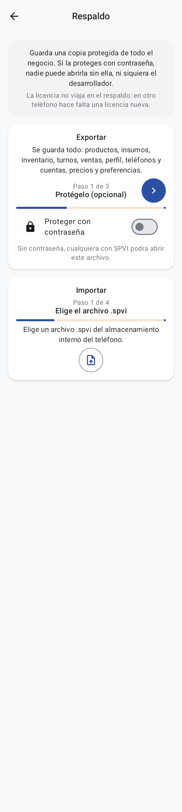

*Figura 13.1 — Exportación protegida con contraseña e importación de archivos `.shalev`*

---

## 14. Tu licencia, precios, renovación y actualizaciones

Shalev incluye **7 días de prueba gratis** desde la primera instalación (con soporte hasta para 5 apps secundarias de empleados). La licencia se gestiona en el teléfono **Principal** y cubre automáticamente a las apps secundarias vinculadas.

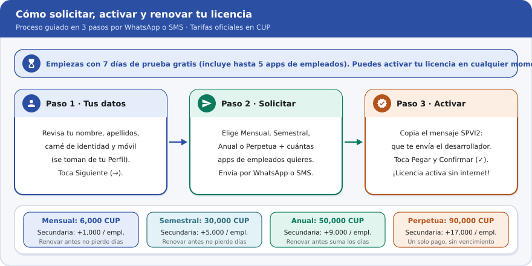

### 14.1 Tarifas oficiales de la licencia (en CUP)

Cada licencia cubre tu **App Principal** y puedes sumarle de **0 a 10 Apps Secundarias** (empleados) según el tamaño de tu equipo:

| Tipo de licencia | Precio base (App Principal) | Adicional por cada App Secundaria (0 a 10) | Ejemplo con 2 empleados |
|---|---:|---:|---:|
| **Mensual** | **6,000.00 CUP** | + 1,000.00 CUP | 8,000.00 CUP |
| **Semestral** *(6 meses)* | **30,000.00 CUP** | + 5,000.00 CUP | 40,000.00 CUP |
| **Anual** *(12 meses)* | **50,000.00 CUP** | + 9,000.00 CUP | 68,000.00 CUP |
| **Perpetua** *(un solo pago, sin vencimiento)* | **90,000.00 CUP** | + 17,000.00 CUP | 124,000.00 CUP |

### 14.2 Cómo pedir y activar tu licencia en 3 pasos

Entra en **Ajustes → Licencia**:

1. **Paso 1 — Revisa tus datos:** comprueba tu nombre, apellidos, carné de identidad y teléfono (se toman de tu *Perfil*). Pulsa **Siguiente (→)**.
2. **Paso 2 — Pide la licencia:**
   - Elige el tipo (**Mensual**, **Semestral**, **Anual** o **Perpetua**) y ajusta con **− / +** cuántas **Apps secundarias (empleados)** necesitas. Verás el total exacto calculado debajo.
   - *(Solo si estás cambiando de teléfono: verifica que aparezca el **ID de la licencia anterior** para que el traspaso sea gratuito; el teléfono viejo quedará revocado y pedirá desinstalar la app).*
   - Elige enviar por **WhatsApp** *(recomendado por rapidez y porque cabe en un solo mensaje)* o por **SMS**, y toca el botón de **Enviar**. Se abrirá tu app de mensajería con tus datos y el código cifrado `SPVIR1:` listos: solo pulsa enviar.
3. **Paso 3 — Activa la licencia:**
   - Cuando el desarrollador te responda con tu mensaje de activación (`SPVI2:`), cópialo completo (si te llegó por SMS dividido en varias partes, copia todas) o compártelo directamente hacia Shalev.
   - En el Paso 3 toca el botón de **Pegar** y luego **Confirmar (✓)**. ¡Listo!

> **Renovar sin perder ni un día:** cuando tengas una licencia activa y se acerque su fecha, puedes usar **Renovar igual** para pedir otra idéntica en dos toques. Si la activas antes de que venza la actual, **los días nuevos se suman a los que te quedaban**.

> **Cuidado con la fecha y hora del teléfono:** para evitar manipulaciones del calendario, si el reloj de tu teléfono se atrasa más de **2 horas**, Shalev bloqueará temporalmente el acceso avisándote **«Fecha u hora incorrecta»**. Basta con volver a poner en hora automática el reloj de Android para seguir trabajando enseguida con todos tus datos intactos.

| 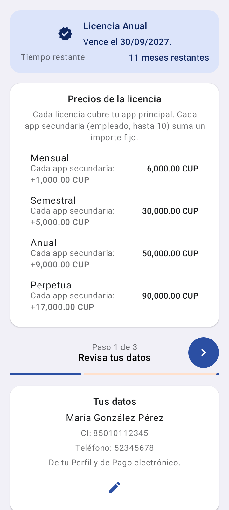 | 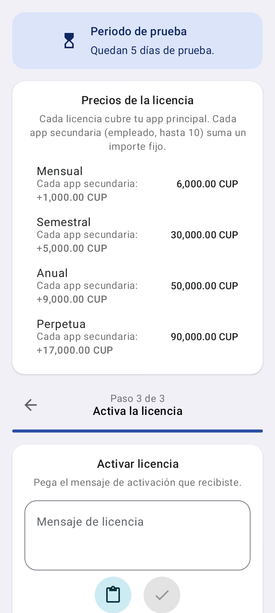 |
|:---:|:---:|
| *Figura 14.1 — Licencia activa, tarifas oficiales y Paso 1* | *Figura 14.2 — Paso 3 para pegar y activar la respuesta* |

### 14.3 Actualizaciones seguras de la aplicación

Para que disfrutes siempre de las últimas mejoras y que la App Principal y las Secundarias hablen el mismo idioma:

- **Búsqueda manual o semanal:** entra en **Ajustes → Actualizar** cuando tengas conexión; aparecerá un cuadro con progreso circular que te indicará *«Estás al día»*, *«Sin conexión»* o descargará e instalará la nueva versión verificada. Además, Shalev comprueba automáticamente una vez por semana si salió una actualización oficial y la reparte por Wi-Fi local a las apps secundarias de tus empleados.
- **Respaldo automático antes de instalar:** justo antes de abrir el instalador de una nueva versión, Shalev guarda internamente una copia automática de tus datos y la restaura al abrir la versión actualizada (evita hacer ventas entre la descarga y el final de la instalación).
- **Plazo de 30 días:** cuando el teléfono detecta una versión nueva, puedes posponerla con *«Más tarde»* durante **30 días** (viendo la fecha límite). Cumplido ese plazo, Shalev pedirá actualizar para continuar, permitiéndote siempre cerrar tu turno abierto y exportar un respaldo antes.

---

## 15. Seguridad, preguntas frecuentes y soporte técnico

### 15.1 Protección de tu privacidad en el día a día

- **Acceso con clave opcional (*Ajustes → Acceso con clave*):** cuando lo enciendes, Shalev pide tu huella dactilar, tu rostro o el PIN/patrón del teléfono al abrir la aplicación desde cero y cuando llevas **10 minutos o más** fuera de ella. Si sales un momento a WhatsApp o a la cámara para volver enseguida, no te interrumpe, y si se bloquea con una venta a medias, tu carrito sigue intacto al desbloquear.
- **Pantallas confidenciales protegidas:** en *Perfil*, *Licencia*, *Clientes fijos*, *Datos de transferencia* y *Códigos QR*, Shalev impide capturas accidentales y oculta la vista previa en la pantalla de *Aplicaciones recientes* de Android.
- **Datos enmascarados:** las tarjetas muestran solo sus últimos 4 dígitos en las listas y los carnés de identidad se protegen en los textos compartidos.

### 15.2 Preguntas frecuentes (solución rápida de dudas)

1. **¿Por qué no veo el botón para vender?**
   Porque el turno está cerrado. Sube al principio de **Inicio**, activa el interruptor **Turno cerrado → Turno abierto**, indica el fondo de caja y aparecerá enseguida el botón flotante del carrito abajo a la izquierda.
2. **¿Por qué un producto Elaborado dice «Alcanza para 0» y no me deja venderlo?**
   Porque al menos uno de los ingredientes de su receta se agotó o tiene menos cantidad de la que pide una unidad. Entra en **Inventario**, filtra por **Tipo: Insumos** y repón la existencia del insumo faltante.
3. **¿Por qué el código QR de Transfermóvil no le pone el precio solo al cliente?**
   Porque el estándar oficial del QR de cuentas/tarjetas en Transfermóvil no admite el campo de importe. El cliente escanea el QR para no tener que teclear los 16 dígitos de tu tarjeta ni tu móvil, y solo escribe el **Importe a transferir** que Shalev le muestra debajo.
4. **¿Qué hago si un empleado no logra sincronizar con mi teléfono?**
   Comprueba que ambos teléfonos estén conectados a la misma red Wi-Fi del local (o a la Zona Wi-Fi del teléfono principal) y que la App Principal esté abierta o con su notificación activa. Mientras tanto, el empleado puede seguir vendiendo sin perder nada.
5. **¿Puedo corregir una venta de ayer cuyo turno ya cerré?**
   No: los turnos cerrados quedan sellados para garantizar que los arqueos históricos cuadren siempre. Solo puedes modificar o anular ventas dentro de un turno **abierto** desde la App Principal.

### 15.3 Ayuda integrada y contacto con el desarrollador

Dentro de la propia aplicación cuentas siempre con **Ajustes → Ayuda** (un manual resumido por temas con pequeños esquemas visuales que funciona sin conexión) y con **Ajustes → Soporte** para comunicarte directamente con el autor de Shalev:

- **Desarrollador:** Ing. Ronnie Montero Duarte
- **Especialidad:** Desarrollo de sistemas y aplicaciones multiplataforma
- **Teléfono / WhatsApp / SMS:** `+53 51815604` (`51815604`)

> **Recuerda siempre:** soporte técnico **jamás** te pedirá la contraseña de tus respaldos `.shalev`, tu PIN del teléfono ni los códigos privados de tus tarjetas bancarias.

| 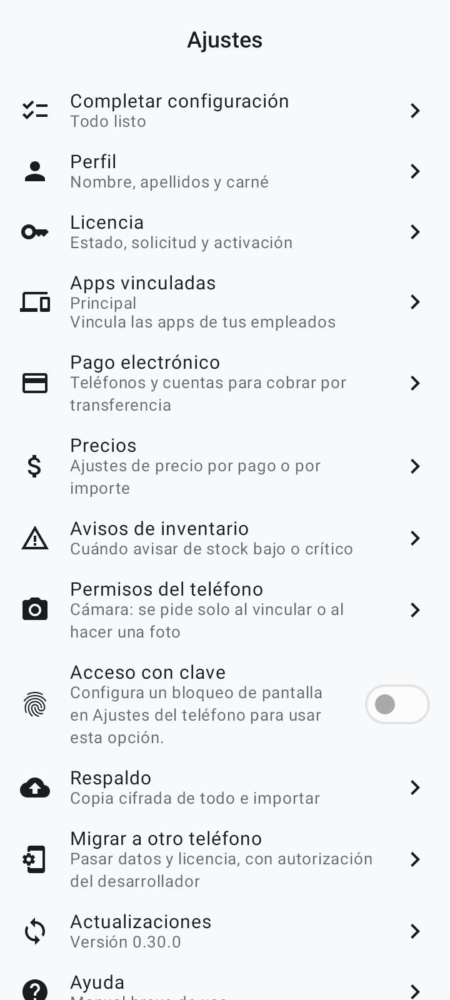 | 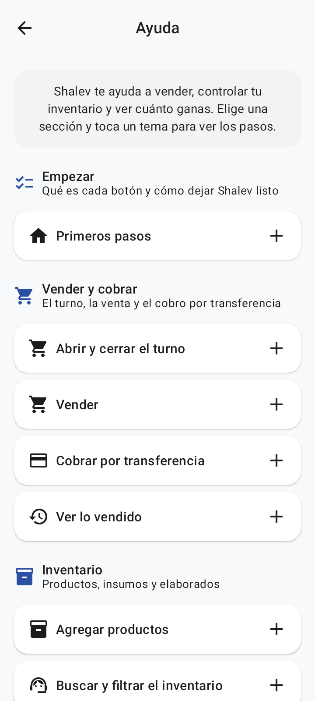 | 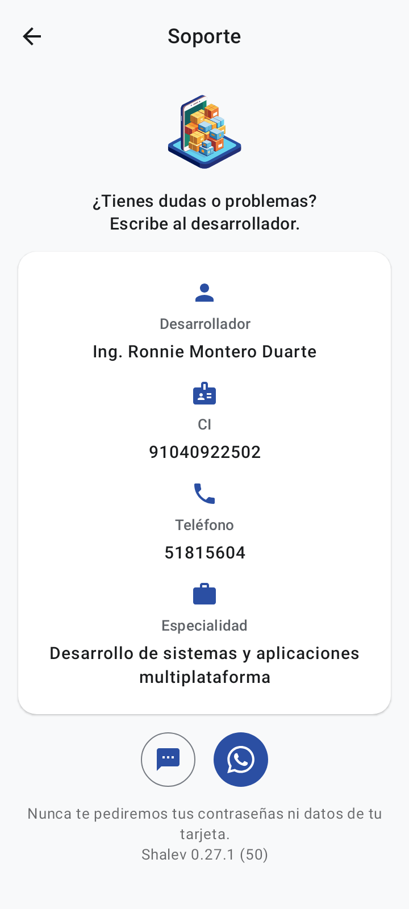 |
|:---:|:---:|:---:|
| *Figura 15.1 — Menú completo de Ajustes* | *Figura 15.2 — Ayuda rápida dentro de la app* | *Figura 15.3 — Contacto directo con Soporte* |
